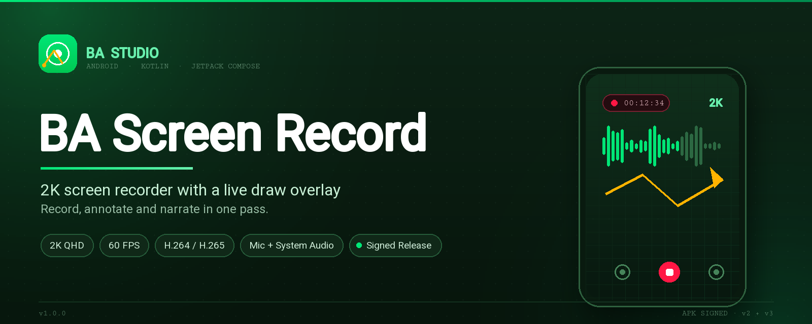
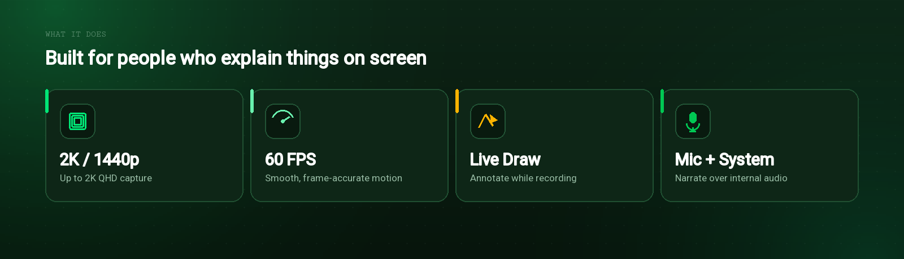
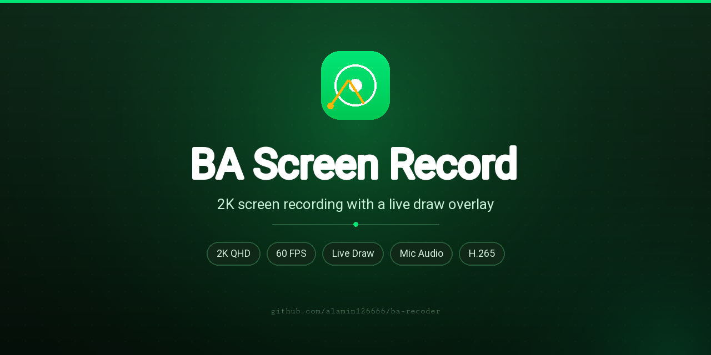

<div align="center">



<br />

**Record. Annotate. Narrate.** A screen recorder that lets you draw on top of whatever you are explaining — while you are explaining it.

<br />

[](https://github.com/alamin126666/ba-recoder/releases/latest)
[](https://github.com/alamin126666/ba-recoder/actions/workflows/release.yml)
[](https://kotlinlang.org)
[](#requirements)
[](#license)

<br />

[**Download**](https://github.com/alamin126666/ba-recoder/releases/latest) &nbsp;·&nbsp;
[**Features**](#features) &nbsp;·&nbsp;
[**Install**](#install) &nbsp;·&nbsp;
[**Build**](#build-from-source) &nbsp;·&nbsp;
[**Releasing**](#releasing) &nbsp;·&nbsp;
[**Architecture**](#architecture)

</div>

---

## Why it exists

Most screen recorders make you choose: record now, edit later. BA Screen Record keeps a drawing surface live on top of the screen so a tutorial, a bug report or a lecture can be captured in a single take — with the arrow already drawn where it needs to point.

<br />



---

## Features

<table>
<tr>
<td width="50%" valign="top">

### Capture

| | |
|---|---|
| **Resolution** | 720p · 1080p · 2K QHD (1440p) |
| **Frame rate** | 24 · 30 · 60 · 120 FPS |
| **Bitrate** | 4 · 8 · 16 · 24 Mbps |
| **Codec** | MP4 &mdash; H.264, H.265 / HEVC |
| **Orientation** | Auto, or locked portrait / landscape |

</td>
<td width="50%" valign="top">

### Audio

| | |
|---|---|
| **Microphone** | Voice commentary, mono or stereo |
| **System audio** | Internal app sound, captured alongside |
| **Both at once** | Mic and system audio mixed into one track |
| **Bitrate** | Configurable, 192 kbps by default |
| **Recovery** | Four-stage source fallback &mdash; a silent video is never produced silently |

</td>
</tr>
<tr>
<td width="50%" valign="top">

### Live draw

| | |
|---|---|
| **Tools** | Pen · Arrow · Rectangle · Circle · Text · Highlighter · Stamp · Eraser |
| **Overlay** | Draggable floating bubble, works over any app |
| **Styling** | Colour palette, adjustable stroke width, smoothing |
| **Stamps** | Checkmark and annotation symbols |
| **Persistence** | Drawings optionally burned into the recording |

</td>
<td width="50%" valign="top">

### Recording flow

| | |
|---|---|
| **Countdown** | Configurable lead-in before capture starts |
| **Quick controls** | Pause, draw and stop from the notification |
| **Shake to stop** | Terminate without touching the screen |
| **Touch indicators** | Visualise taps for viewers |
| **Gallery** | Browse, play and manage every recording |

</td>
</tr>
</table>

---

## Install

### From a signed release

```text
1.  Open the Releases page
2.  Download BA-Screen-Record-<version>.apk
3.  Allow installation from your browser or file manager when prompted
4.  Launch, then grant the permissions the app asks for in context
```

> Every published APK carries **v2 and v3** APK signatures, so it installs and updates cleanly on Android 7.0 through Android 16.

### Required permissions

| Permission | When it is requested |
|---|---|
| `RECORD_AUDIO` | Only if you enable microphone narration |
| `FOREGROUND_SERVICE_MEDIA_PROJECTION` | When a recording starts |
| `FOREGROUND_SERVICE_MICROPHONE` | Only alongside microphone capture |
| `POST_NOTIFICATIONS` | On Android 13+, for the recording timer |
| `SYSTEM_ALERT_WINDOW` | Only for the floating draw bubble |
| `WRITE_EXTERNAL_STORAGE` | Android 9 and below, to save to the gallery |

Permissions are requested **at the moment they are needed**, never as a wall at first launch.

---

## Requirements

| | |
|---|---|
| **Minimum** | Android 7.0 (API 24) |
| **Target / compile** | Android 16 &mdash; API 36 (36.1) |
| **JDK** | 21 |
| **Gradle** | 9.3.1 (wrapper included) |
| **Android Gradle Plugin** | 9.1.1 |

---

## Build from source

```bash
git clone https://github.com/alamin126666/ba-recoder.git
cd ba-recoder
./gradlew :app:assembleDebug
```

The debug build installs alongside the release build, so you can keep a known-good copy on the device.

```bash
./gradlew :app:testDebugUnitTest    # unit tests
./gradlew :app:lintDebug            # lint
./gradlew :app:assembleRelease      # optimised build (needs signing config)
```

### Signing a release locally

`app/build.gradle.kts` reads four environment variables and falls back to the debug keystore when they are absent:

```bash
export KEYSTORE_PATH=/absolute/path/to/upload.jks
export STORE_PASSWORD='…'
export KEY_ALIAS='upload'
export KEY_PASSWORD='…'
export VERSION_NAME=1.2.0
export VERSION_CODE=3

./gradlew :app:assembleRelease
```

Generate a Play-compatible keystore without any extra tooling:

```bash
python3 tools/make_keystore.py --out upload.jks
```

It uses `keytool` when a JDK is present and falls back to a pure-Python PKCS#12 writer otherwise — including a self-signed certificate with `SHA256withRSA`, the algorithm every Android version accepts.

---

## Releasing

Releases are produced entirely by **GitHub Actions** — nothing is built on a developer machine.

```text
tag  v*  ──▶  .github/workflows/release.yml
                 │
                 ├──  decode keystore from secrets
                 ├──  R8 minify + resource shrinking
                 ├──  assembleRelease  (signed)
                 ├──  apksigner verify  (fails if v2 or v3 is missing)
                 └──  publish APK to the GitHub Release
```

### Required repository secrets

| Secret | Contents |
|---|---|
| `KEYSTORE_BASE64` | Base64 of the `.jks` upload keystore |
| `STORE_PASSWORD` | Keystore password |
| `KEY_ALIAS` | Key alias inside the keystore |
| `KEY_PASSWORD` | Key password |

Set all four, create the keystore, push and tag in one command:

```bash
python3 tools/release_setup.py --token "$GITHUB_TOKEN" --repo ba-recoder --version 1.0.0
```

### Optimisation profile

| Setting | Value | Effect |
|---|---|---|
| `isMinifyEnabled` | `true` | R8 code shrinking and obfuscation |
| `isShrinkResources` | `true` | Unused resources stripped |
| Optimisation passes | 5 | Full R8 optimisation pipeline |
| `isDebuggable` | `false` | Debuggable flag removed |
| Log stripping | enabled | `android.util.Log` calls removed in release |
| Signing | v2 + v3 | Tamper detection and a rotation-capable lineage |

---

## Architecture

Single-module app, unidirectional data flow, no framework beyond AndroidX.

```text
com.example
├── MainActivity.kt              Compose host, navigation, permission flow
├── presentation/
│   ├── home/                    Recording dashboard (ViewModel + Screen)
│   └── settings/                Capture, audio, overlay and theme settings
├── service/
│   ├── ScreenRecordService.kt   Foreground service, MediaProjection + mic
│   └── DrawOverlayService.kt    Floating draw surface over other apps
├── recording/
│   ├── ScreenRecordManager.kt   MediaRecorder lifecycle
│   ├── AudioRoutePlan.kt        Pure audio-route fallback planner
│   └── RecordingFileManager.kt  Output paths and MediaStore insertion
├── data/                        DataStore settings, Room gallery, repository
└── domain/model/                Resolution, FPS, bitrate, codec, draw tools
```

<br />

### Audio: why it used to drop the voice

A screen recorder runs as a foreground service, and from Android 14 that service must declare **every** sensor it captures in its `foregroundServiceType`. Declaring only `mediaProjection` while still opening the microphone means the system silently mutes the mic as soon as the app leaves the foreground — which is precisely when screen recording happens. The result is a recording that sometimes has a voice and sometimes does not.

The fix declares the type correctly, and adds a fallback planner so a device that rejects one audio configuration still produces sound:

```text
CAMCORDER · stereo
      └─▶ MIC · stereo
              └─▶ MIC · mono
                      └─▶ DEFAULT · mono
                              └─▶ video only, with an explicit warning
```

`AudioRoutePlan` is a pure Kotlin object with no Android dependencies, covered by a unit test that asserts the exact candidate order — the regression cannot come back unnoticed.

---

## Testing

```bash
./gradlew :app:testDebugUnitTest
```

| Suite | Covers |
|---|---|
| `AudioRoutePlanTest` | Candidate ordering, mono/stereo fallback, no-silent-failure guarantee |

CI runs the unit tests and lint on every push to `main`. Lint is reported but does not block, so a style warning never stops a security fix from landing.

---

## Project structure

```text
.
├── .github/workflows/       release.yml · ci.yml
├── app/
│   ├── build.gradle.kts     signing, optimisation, version stamping
│   ├── proguard-rules.pro   R8 configuration
│   └── src/
│       ├── main/java/com/example/…
│       ├── main/res/…
│       └── test/java/com/example/…
├── docs/banners/            hero · features · social preview
├── gradle/libs.versions.toml
├── tools/
│   ├── make_banners.py      regenerates the artwork in this README
│   ├── make_keystore.py     keystore without a JDK
│   ├── sealed_box.py        NaCl sealed-box for secret upload
│   ├── ayan_push.py         git-free repository push over the GitHub API
│   └── release_setup.py     keystore + secrets + push + tag, one command
└── RELEASE.md               full release operations runbook
```

---

## Regenerating the artwork

The banners in this README are **generated from code**, not exported from a design tool. Brand colours are read from the app's own `colors.xml`, so the artwork and the running UI never drift apart.

```bash
pip install pillow
python3 tools/make_banners.py
```

| Output | Size | Used for |
|---|---|---|
| `docs/banners/hero.png` | 1600 × 640 | README header |
| `docs/banners/features.png` | 1600 × 460 | Feature strip |
| `docs/banners/social-preview.png` | 1280 × 640 | GitHub social preview |

---

## Contributing

```bash
git checkout -b fix/short-description
# … change code, then
./gradlew :app:testDebugUnitTest :app:lintDebug
git commit -m "fix(audio): …"
git push -u origin fix/short-description
```

Two rules that matter more than style: **keep the audio fallback chain intact** (it is what prevents silent recordings), and **never commit a keystore or a password** — `.env`, `*.jks` and `secrets.json` are already ignored.

---

## License

Copyright © 2026 BA Studio.

Released for personal, educational and internal business use. Redistribution of the compiled application, or of modified versions, requires written permission from the author. The source is published for reference, review and contribution.

---

<div align="center">



**BA Studio** &nbsp;·&nbsp; built with Kotlin and Jetpack Compose

<sub>If this saved you a recording, a star helps.</sub>

</div>